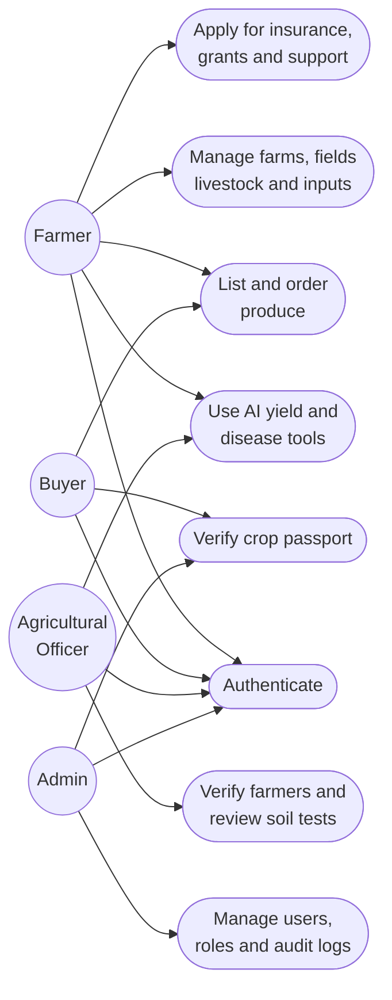
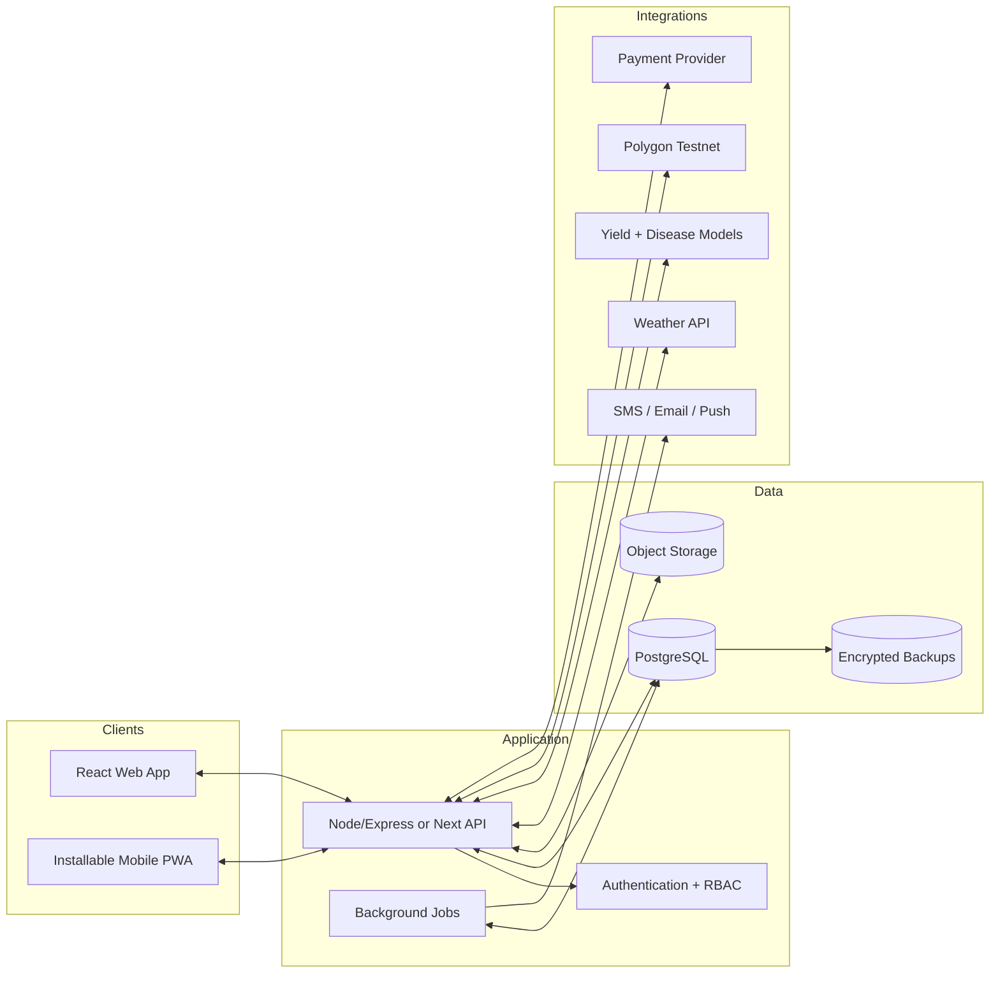
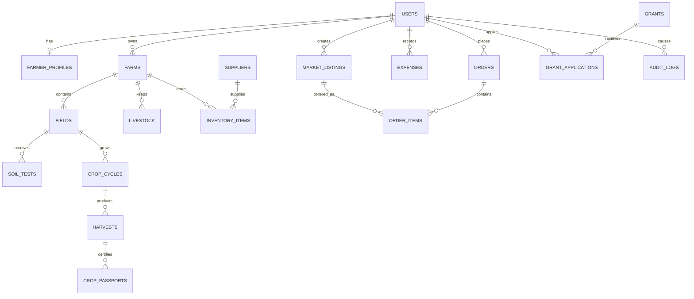
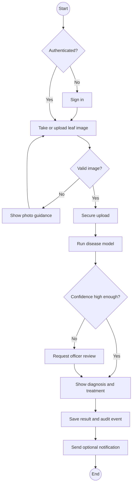
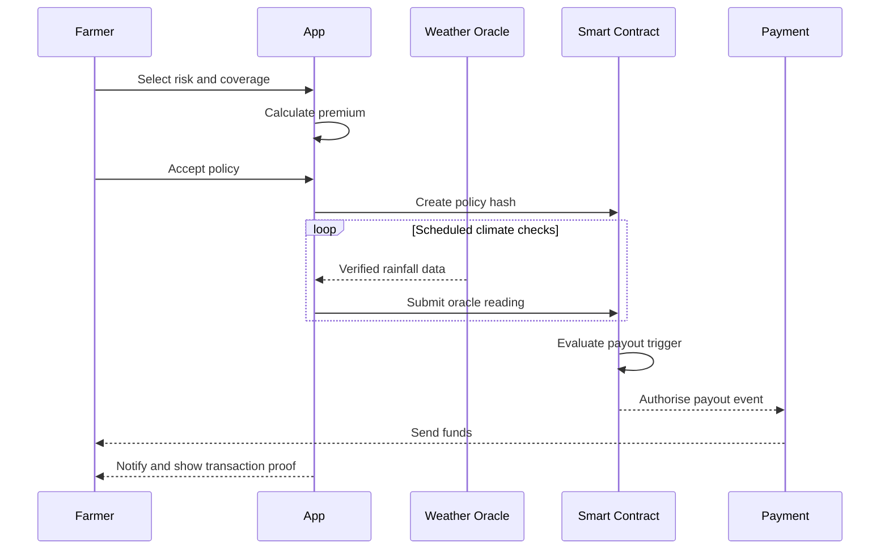

# Letsatsi ClimateShield System Diagrams

These diagrams adapt the supplied UML, frontend/backend, ERD and activity references to the ClimateShield project. Mermaid diagrams render in GitHub and many VS Code Markdown extensions.

## 1. Role and use-case diagram

## 2. Target architecture

## 3. Core PostgreSQL ERD

## 4. Crop disease analysis activity

## 5. Parametric insurance activity

## Prototype boundary

The current frontend demonstrates these workflows with local data. The database, weather, AI inference, blockchain and payment boxes are target integrations and must not be described as live until the corresponding services are connected and tested.
